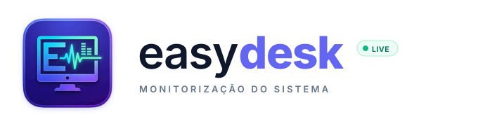
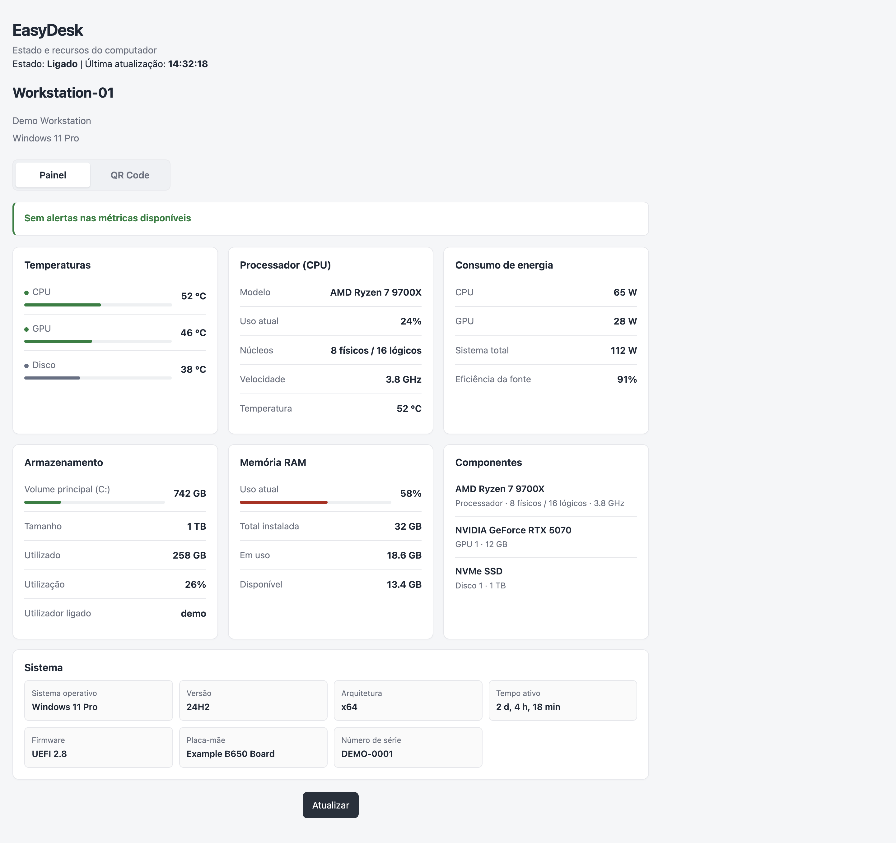

<p align="center">
  <picture>
    <source media="(prefers-color-scheme: dark)" srcset="assets/branding/EasyDesk-logo-horizontal-dark.svg">
    <source media="(prefers-color-scheme: light)" srcset="assets/branding/EasyDesk-logo-horizontal.svg">
    
  </picture>
</p>

# EasyDesk

Aplicação de ambiente de trabalho e painel web para consultar informações sobre o computador onde o EasyDesk está a correr.

<p align="center">
  
</p>

## Funcionalidades

- Painel com dados de CPU, memória, armazenamento, discos, rede e sistema operativo.
- Aplicação de ambiente de trabalho para Windows, macOS e Linux.
- Acesso opcional ao painel a partir de outros dispositivos na mesma rede local.
- Leituras térmicas sujeitas ao hardware, aos controladores e ao sistema operativo.

## Site de downloads

[Transferir EasyDesk para Windows, macOS e Linux](https://mourinho23.github.io/EasyDesk/)

O site inclui um chat com um modelo de IA que corre no navegador, sem chave de API nem conta. Na primeira conversa, o navegador descarrega o modelo (cerca de 1,5 GB com WebGPU ou até 920 MB em modo compatível); depois, as perguntas são processadas localmente. O modo compatível usa um modelo mais pequeno para funcionar em mais dispositivos e evitar os limites de memória do navegador. É necessária uma ligação à Internet para carregar a biblioteca e o modelo. A capacidade e a velocidade dependem do dispositivo; por ser um modelo local, a qualidade não é igual à de assistentes maiores na cloud.

## Instalar e abrir

Descarrega o instalador adequado no site EasyDesk:

- **Windows:** executa o instalador `.exe` e segue as instruções. Podes autorizar opcionalmente a instalação automática do Node.js 24 LTS. O MSI é executado em segundo plano, sem terminal ou assistente adicional; o Windows pode pedir confirmação de administrador. O EasyDesk não precisa do Node.js para funcionar.
- **macOS:** escolhe Apple Silicon ou Intel, abre o `.dmg` e arrasta EasyDesk para **Aplicações**. As versões ainda não estão assinadas nem notarizadas; o macOS poderá apresentar avisos de segurança.
- **Linux:** usa o AppImage, `.deb` (Debian, Ubuntu e derivados) ou `.rpm` (Fedora, openSUSE e derivados). Algumas distribuições podem exigir FUSE para executar AppImages.

## Executar em modo de desenvolvimento

### Requisitos

- Node.js 22.12 ou superior
- npm (incluído com Node.js)

Na pasta do projeto, instala as dependências e inicia a aplicação desktop:

```sh
npm ci
npm run desktop
```

Para executar apenas o servidor web:

```sh
npm start
```

O terminal indica o endereço do painel. Para parar o servidor iniciado com `npm start`, carrega em **Ctrl+C**. Para fechar a aplicação desktop, fecha a respetiva janela.

No Windows, também podes abrir o atalho de desenvolvimento `Iniciar EasyDesk.lnk`, que inicia o servidor e abre o painel no browser.

## Criar instaladores

Instala Node.js 22.12 ou superior e executa os comandos a partir da pasta do projeto. Para compilar o auxiliar opcional de sensores do Windows, instala também o .NET SDK 8. A criação do instalador Windows descarrega a versão LTS 24 mais recente do MSI oficial do Node.js e verifica o respetivo SHA-256 antes de a incluir. Cria cada instalador no respetivo sistema operativo:

| Sistema onde estás a compilar | Comando | Ficheiro gerado |
| --- | --- | --- |
| Windows | `npm run dist:win` | Instalador `.exe` |
| macOS | `npm run dist:mac` | Imagem `.dmg` |
| Linux | `npm run dist:linux` | `.AppImage`, `.deb` e `.rpm` (x64) |

Primeiro instala as dependências. Para o instalador Windows, é necessária uma ligação à Internet para obter o MSI do Node.js:

```sh
npm ci
```

As releases Windows são assinadas com Authenticode quando os secrets `WINDOWS_SIGNING_CERTIFICATE_BASE64` (certificado PFX codificado em Base64) e `WINDOWS_SIGNING_CERTIFICATE_PASSWORD` estão configurados. Sem esses secrets, o workflow publica um instalador sem assinatura e o SmartScreen poderá apresentar avisos. A assinatura identifica o editor, mas a reputação SmartScreen e os falsos positivos de antivírus dependem também dos fornecedores.

Depois executa **apenas o comando correspondente ao sistema onde estás a compilar**. Os ficheiros finais são colocados em `release/`. A compilação macOS pode necessitar das ferramentas de linha de comandos da Apple. O workflow `release.yml` compila automaticamente em Windows, macOS e Linux quando é enviada uma etiqueta de versão válida.

## Sensores e leituras

O instalador Windows apresenta duas opções: sem o auxiliar adicional de sensores ou com o auxiliar de temperatura e potência baseado no LibreHardwareMonitor. A segunda opção requer permissões de administrador, instala um serviço protegido do Windows e necessita do .NET Framework 4.7.2 ou superior. O serviço só é iniciado enquanto o EasyDesk está aberto e é parado quando a aplicação fecha. As leituras continuam dependentes dos sensores expostos pelo hardware e pelos controladores.

No macOS, o instalador inclui o leitor adequado a Macs Intel ou Apple Silicon. A leitura de potência usa o `powermetrics` fornecido pelo sistema e requer privilégios de administrador. No Linux, as temperaturas são lidas diretamente dos sensores expostos pelo kernel; a potência da CPU só fica disponível quando o kernel publica contadores Intel/AMD RAPL.

Os valores de potência total do sistema e de eficiência da fonte só aparecem se o próprio hardware expuser esses sensores. O EasyDesk não estima nem inventa leituras. Nenhum instalador instala controladores do fabricante ou módulos de kernel, e a disponibilidade varia conforme o equipamento e o sistema operativo.

## Acesso a partir da rede local

O servidor mostra no arranque o endereço que podes abrir no próprio computador. Para acederes a partir de um telemóvel ou de outro computador, liga ambos à mesma rede e abre nesse dispositivo o endereço LAN indicado pelo servidor.

O código QR é gerado localmente, sem depender da Internet, e usa o nome `.local` deste computador para continuar válido se o endereço IP mudar. O computador tem de estar ligado e acessível na rede local para o painel abrir; um NFC não consegue mostrar dados de um computador desligado ou sem rede.

Cada computador executa a sua própria instância e apresenta apenas os dados da máquina que está a servir o painel. O EasyDesk não agrega várias máquinas num único painel. Se o servidor deixar de responder, o estado e os campos de armazenamento e utilizador passam a **Desligado**.

## QR code e URL pública

O código QR do painel pode apontar para um URL público em vez do endereço local `.local` quando quiseres usar o painel em ecrãs externos ou partilhar o acesso com mais facilidade. Define uma destas variáveis antes de iniciar o servidor:

```sh
EASYDESK_QR_URL=https://painel.exemplo.pt
# ou
EASYDESK_PUBLIC_URL=https://painel.exemplo.pt
```

Se não definir nenhuma variável, o EasyDesk continua a usar o endereço local do computador.

## Segurança e privacidade

O servidor destina-se a uso numa rede local e ainda não tem autenticação própria. Enquanto estiver ativo, outros dispositivos que consigam aceder ao endereço poderão consultar os dados apresentados, incluindo o nome de utilizador e informações do sistema. Não encaminhes a porta 3000 para a Internet nem uses uma rede pública ou não fiável para partilhar o painel.
